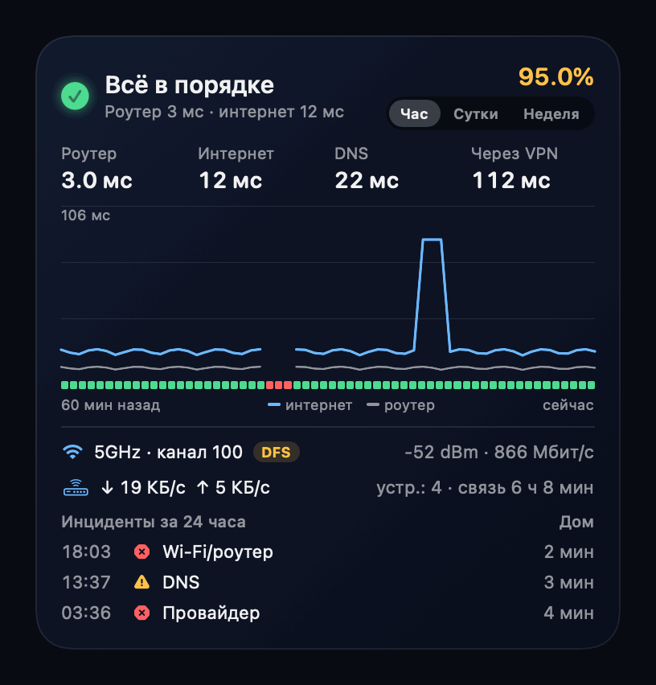
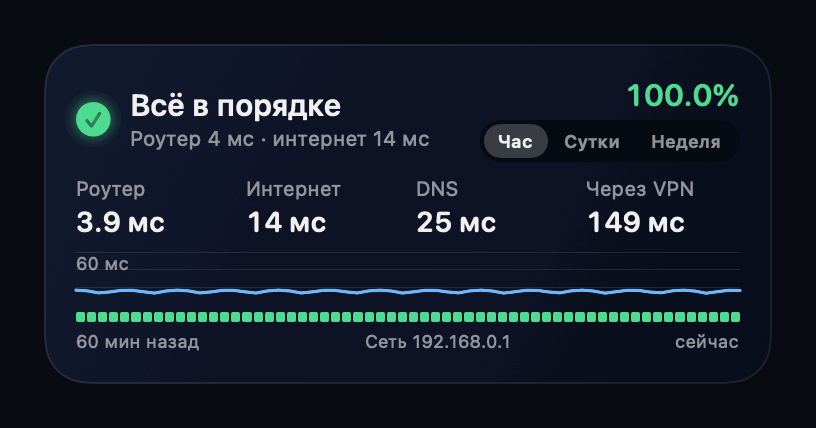
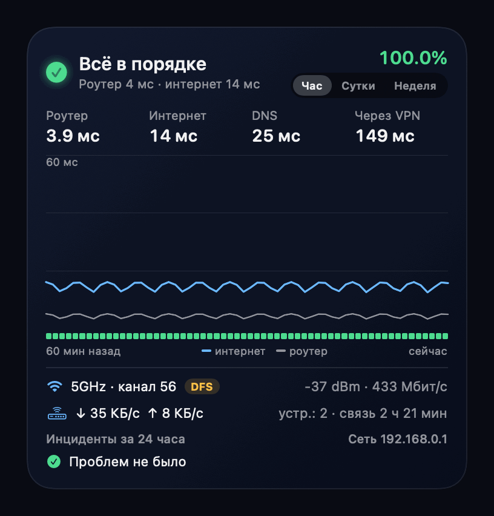

# NetWatch

[🇷🇺 Русский](README.md) · 🇬🇧 English

Home network diagnostics for macOS. It answers "where does it break": Wi-Fi/router, provider, DNS or VPN.

All measurements (except HTTPS) are bound to the physical interface (`en0`), so a VPN cannot distort them. HTTPS goes
over the default route and shows what apps actually experience.

License: [MIT](LICENSE).

## Features

- **Where it breaks.** Wi-Fi/router, provider, DNS and VPN are told apart. Short glitches are not counted as problems, while repeated ones are merged into incidents.
- **A widget** in medium and large sizes: a colored status, a graph with an hour · day · week switch, and a click that opens the app.
- **Notifications** about a problem that lasts longer than a minute, with the likely cause.
- **Causes of latency spikes.** This Mac's own traffic, AWDL (AirDrop and Handoff), power saving, CPU load, other devices on the network.
- **Every network on its own.** Home, campus and a phone hotspot are counted separately. Networks that drop ping are recognized automatically.
- **Tenda router.** Traffic through the router, number of devices, how long the provider connection has held. The data is read without a password and nothing is ever written to the router.
- **Frugal.** One measurement every 30 s, faster only while there is a problem, slower on battery.

## What it looks like

The animations are drawn in code from synthetic data (`scripts/make-gifs.sh`), so they contain nothing about a real network.

**Graph period: hour, day, week.** The buttons in the widget header work right on the desktop.



**What a problem looks like.** The connection turns unstable (yellow), then nothing gets through the router (red),
then everything recovers. The strip under the graph shows the state minute by minute.



The large widget adds Wi-Fi, router data and a list of incidents.



## Requirements

- macOS 15 or later.
- Xcode and [xcodegen](https://github.com/yonaskolb/XcodeGen) to build the app and the widget.
- An Apple Development certificate (a free Apple ID is enough).

## Structure

- `Sources/NetWatchCore` — the core: measurements, diagnosis, incidents, networks, storage, the adaptive scheduler, the report.
- `Sources/NetWatchUI` — the widget views, shared by the widget and the app window.
- `Sources/netwatchd` — the command-line agent.
- `App/` and `Widget/` — the host app (settings window, notifications) and the widget extension.
- `Tests/` — tests for the diagnosis logic, networks, notifications, the router and storage.
- `scripts/` — installing the agent and the app, redrawing the animations.

## Usage

```bash
swift build -c release
.build/release/netwatchd run          # background collection (30 s, every 3 s during problems, slower on battery)
.build/release/netwatchd once         # one measurement
.build/release/netwatchd report --hours 24 [--network NAME]   # report, one per network
.build/release/netwatchd networks     # networks this Mac has been on
.build/release/netwatchd name current "Campus A"   # name the current network
.build/release/netwatchd router       # what the router reports right now (Tenda)
```

Log: `~/Library/Application Support/NetWatch/samples-YYYY-MM-DD.jsonl` (kept for 30 days).

## Widget

A medium and a large widget for the macOS widget panel: a colored status, four key numbers, a latency graph
with a state strip, and the large one also shows Wi-Fi (channel, DFS, signal), router data and recent incidents.
The day and week graphs are built from 15-minute summaries (`rollups.json`) that the agent maintains.

```bash
scripts/install.sh        # the logging agent (launchd), collects the data
scripts/install-app.sh    # the app + widget → ~/Applications/NetWatch.app (needs xcodegen)
```

Signing needs an Apple Development certificate (a free Apple ID is enough): the team is taken from it automatically,
or set it by hand: `NETWATCH_TEAM=ABCDE12345 scripts/install-app.sh`. Replace the bundle identifiers (`com.egor.*`) with your own in `project.yml` and `scripts/install.sh`.

To add it: right-click the desktop → "Edit Widgets" → NetWatch.

- `project.yml` describes the Xcode project (`NetWatch.xcodeproj` is generated and not kept in git).
- `swift run netwatch-preview build/previews` draws the widget to PNG without WidgetKit.
- The app icon is drawn in code (`Sources/netwatch-icon`): `swift run netwatch-icon App/Assets.xcassets/AppIcon.appiconset`.
- The widget runs sandboxed and reads the agent's log through a narrow read-only exception
  (`com.apple.security.temporary-exception.files.home-relative-path.read-only`). That is not accepted for the App Store, but is fine for a personal install.
- The system refreshes the extension on its own budget, so the host app watches the log and asks for a refresh
  when the state changes and once a minute. The app runs in the background: it has no Dock icon, and its window opens when you click the widget.

## What counts as a problem

| Verdict | Condition |
|---|---|
| No network | no interface or router |
| Wi-Fi/router | nothing gets through: neither the router nor the internet |
| Provider | the router answers, but both external addresses are unreachable directly |
| DNS | the DNS server does not answer |
| VPN | the direct path works, but HTTPS through the VPN does not |
| Degraded | more than 20% of echoes lost, the router's ICMP silent while the internet works, router >30 ms, internet >150 ms, DNS >300 ms, HTTPS >3 s |

The verdict is recomputed from the raw measurements when the log is read, so changes to the rules also apply to old data.

The report also flags Wi-Fi channel changes and incidents that coincide with DFS channels (52–64, 100–144).

## Privacy

Data stays on your Mac. To check connectivity the agent contacts your router and your DNS servers, as well as
1.1.1.1, 8.8.8.8 and a page on apple.com, nothing else. It only reads the router, and no password is needed.
